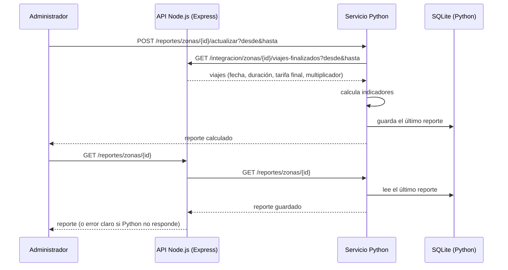

# Parte Python — Servicio de reportes de precio dinámico

La cátedra pide que una parte del proyecto esté hecha en Python. La vamos a hacer
como un **servicio aparte**, con su propio código, base y tests, que se comunica
con el backend de Node.js **solamente por API HTTP**. La decisión y sus
alternativas están en [ADR-0007](adr/0007-servicio-python-integrado-por-http.md).

> Estado: **planificado**. Todavía no hay código Python. Este documento fija el
> alcance y el contrato para empezar.

## 1. Qué hace y qué no hace

El servicio Python produce un **reporte operativo del precio dinámico por zona de
demanda**. Para una zona y un período calcula:

1. **Cantidad de viajes finalizados.**
2. **Suma de las tarifas finales** (cobro simulado).
3. **Duración promedio** de los viajes.
4. **Multiplicador promedio aplicado** y **porcentaje de viajes con multiplicador
   mayor que 1**, para ver cuánto pesó la demanda en esa zona.

No hace:

- nada del flujo principal: pedir, cotizar, asignar, cancelar o cobrar viajes sigue
  siendo de Node.js;
- predicciones, mapas, inteligencia de rutas ni recálculo de precios;
- acceso a la base PostgreSQL de Node.

Node.js sigue siendo la **fuente oficial** de viajes, cotizaciones, zonas y
precios. Python solo guarda una copia de los indicadores que calculó.

## 2. Arquitectura



- Dos servicios separados, cada uno con su base: PostgreSQL para Node y SQLite para
  Python.
- La consulta de Node a Python **no** vuelve a llamar a Node: lee lo guardado. Así
  no hay una cadena circular de pedidos.
- Los dos se levantan con Docker Compose (un servicio `reportes` nuevo en
  `compose.yaml`).

## 3. Contrato entre las dos API (propuesta)

HTTP con JSON. Los nombres definitivos se acuerdan en `docs/api.md` antes de
programar. Ninguno de estos endpoints existe todavía.

### 3.1 Node.js → expone para Python

`GET /integracion/zonas/{zonaId}/viajes-finalizados?desde=<ISO-8601>&hasta=<ISO-8601>`

- Autenticación: cabecera `Authorization: Bearer <credencial de servicio>` (no es un
  JWT de usuario).
- Devuelve solo lo necesario, **sin nombres, emails ni ubicaciones**:

```json
{
  "zonaId": "…",
  "desde": "2026-11-01T00:00:00Z",
  "hasta": "2026-11-08T00:00:00Z",
  "viajes": [
    {
      "id": "…",
      "finalizadoEn": "2026-11-02T14:10:00Z",
      "duracionS": 840,
      "tarifaFinalCentavos": 297500,
      "multiplicador": "1.25"
    }
  ]
}
```

- Errores: 401 sin credencial, 404 zona inexistente, 400 rango inválido (por ejemplo,
  `desde` posterior a `hasta` o un rango mayor que el máximo configurado).

### 3.2 Python → expone

| Método y ruta                                          | Quién lo llama                          | Qué hace                                                                                                                                                          |
| ------------------------------------------------------ | --------------------------------------- | ----------------------------------------------------------------------------------------------------------------------------------------------------------------- |
| `POST /reportes/zonas/{zonaId}/actualizar?desde&hasta` | Administrador (o un proceso programado) | Pide los viajes a Node, calcula los indicadores y guarda el resultado. Si Node no responde, devuelve **503** con un mensaje claro y conserva el reporte anterior. |
| `GET /reportes/zonas/{zonaId}`                         | Node.js                                 | Devuelve el último reporte guardado, con la fecha en que se calculó. **No** llama a Node. 404 si nunca se calculó.                                                |
| `GET /health`                                          | Docker y monitoreo                      | Indica si el servicio está vivo.                                                                                                                                  |

Respuesta del reporte:

```json
{
  "zonaId": "…",
  "desde": "2026-11-01T00:00:00Z",
  "hasta": "2026-11-08T00:00:00Z",
  "viajesFinalizados": 3,
  "sumaTarifasCentavos": 812000,
  "duracionPromedioS": 905,
  "multiplicadorPromedio": "1.17",
  "porcentajeConMultiplicador": 66.7,
  "calculadoEn": "2026-11-08T10:00:00Z"
}
```

### 3.3 Node.js → consume de Python

`GET /reportes/zonas/{zonaId}` en Node, solo para el rol administrador. Node
reenvía la consulta a Python con tiempo máximo de espera y, si Python no responde,
devuelve **503** con un mensaje claro. El resto de la API no se ve afectado.

## 4. Reglas que tienen que cumplir los dos lados

- **Credencial de servicio** por variable de entorno en cada servicio (por ejemplo
  `REPORTES_SERVICE_TOKEN` en los dos `.env`), nunca en el código ni en el repositorio.
- **Tiempo máximo de espera** en cada llamada (valor inicial a configurar, por
  ejemplo 3 segundos).
- **Node no depende de Python**: si Python está caído, pedir y asignar viajes sigue
  funcionando. Se prueba deteniendo el contenedor de Python.
- **Sin datos personales** en el endpoint de integración.
- Montos en **centavos enteros** y multiplicador como **texto decimal**, igual que en
  Node, para no perder precisión.
- Fechas en ISO-8601 con zona horaria (UTC).

## 5. Tecnología propuesta para Python

Propuesta a confirmar por quien lo implemente:

- Python 3.12 o posterior.
- **FastAPI** para la API, con validación de entrada y salida con Pydantic.
- **httpx** como cliente HTTP hacia Node, con tiempo máximo de espera.
- **SQLite** con el módulo `sqlite3` de la biblioteca estándar.
- **pytest** para los tests.

Estructura sugerida, en una carpeta propia del repositorio:

```text
reportes/
├── app/
│   ├── main.py          # API FastAPI
│   ├── indicadores.py   # cálculo puro de los indicadores
│   ├── cliente_node.py  # llamadas HTTP a Node
│   └── almacen.py       # lectura y escritura en SQLite
├── tests/
├── .env.example
├── requirements.txt
├── Dockerfile
└── README.md
```

## 6. Qué tiene que existir antes en Node.js

El reporte usa datos que Node todavía no tiene:

- zonas de demanda y multiplicador fijado en cada viaje (RF-16, RF-17 y RF-18);
- inicio y fin del viaje, para calcular la duración, y tarifa final (RF-12 y RF-13);
- el endpoint de integración de la sección 3.1.

Mientras tanto, la parte Python se puede programar y probar con **respuestas
simuladas de Node**.

## 7. Tareas

1. Acordar el contrato de la sección 3 en `docs/api.md`.
2. Crear la carpeta `reportes/` con la API, el cálculo de indicadores y SQLite.
3. Tests de Python:
   - cálculo de los indicadores (lista vacía, un viaje y varios viajes);
   - actualización con respuestas simuladas de Node;
   - Node no disponible: responde 503 y conserva el reporte anterior;
   - consulta sin credencial de servicio: 401.
4. En Node: endpoint de integración, adaptador HTTP hacia Python (puerto nuevo) y
   endpoint `GET /reportes/zonas/{id}` para el administrador.
5. Servicio `reportes` en `compose.yaml` y documentación de arranque en el README.

## 8. Demostración

1. Levantar todo con Docker Compose y preparar una zona con dos o tres viajes
   finalizados.
2. Pedir a Python que actualice el reporte de esa zona y verificar en los logs que
   consultó a Node.
3. Consultar el reporte desde Node y comprobar los valores.
4. Detener el contenedor de Python: el reporte en Node responde 503 y el flujo de
   viajes sigue funcionando.
